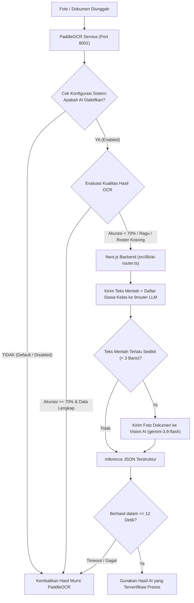

# Rencana Implementasi: Integrasi Opsional 9router AI & OCR Smart Fallback

## Ringkasan Fitur
Menambahkan integrasi kecerdasan buatan lokal (**9router AI**) ke dalam sistem pemindaian OCR (Surat Izin Siswa dan Impor Roster Siswa). Fitur AI ini bersifat **opsional** dengan sakelar (*toggle*) di menu Pengaturan Superadmin:
- **Kondisi Nonaktif (Default / Disabled)**: Seluruh pemrosesan dokumen/foto ditangani 100% oleh **PaddleOCR lokal** tanpa pemanggilan ke 9router AI sama sekali. Input konfigurasi dan tombol pengujian dinonaktifkan (*disabled*).
- **Kondisi Aktif (Enabled)**: Menggunakan alur **Smart Fallback** — PaddleOCR memproses terlebih dahulu secara lokal; jika tingkat akurasi nama < 70%, nama siswa tidak cocok di kelas, tanggal tidak terbaca, atau baris roster kosong, sistem secara otomatis meminta bantuan ke 9router AI (timeout maksimal 12 detik).

---

## User Review Required
> [!IMPORTANT]
> 1. **Default Sistem**: Kolom database `ai_enabled` bernilai bawaan `false` (0). Semua instalasi baru atau yang sudah ada tetap berjalan 100% lokal via PaddleOCR sampai Superadmin sengaja mengaktifkannya.
> 2. **State Tombol Uji Koneksi**: Sesuai kesepakatan, saat sakelar AI dalam posisi Nonaktif (*disabled*), tombol **"Uji Koneksi Sekarang"**, tombol **"Ambil Model"**, dan field input konfigurasi berada dalam kondisi *disabled*.
> 3. **Perubahan Skema Database**: Tabel `system_settings` akan ditambahkan 4 kolom baru (`ai_enabled`, `ai_router_url`, `ai_router_api_key`, `ai_router_model`) melalui perintah `ALTER TABLE ... ADD COLUMN IF NOT EXISTS`.

---

## Arsitektur Alur Kerja



---

## Rincian Perubahan Berkas

### 1. Database & Konfigurasi Sistem
- **`src/db/schema.ts`** `[MODIFY]`:
  Tambahkan kolom ke tabel `systemSettings`:
  ```ts
  aiEnabled: boolean("ai_enabled").notNull().default(false),
  aiRouterUrl: varchar("ai_router_url", { length: 255 }).notNull().default("http://127.0.0.1:20128/v1"),
  aiRouterApiKey: varchar("ai_router_api_key", { length: 255 }),
  aiRouterModel: varchar("ai_router_model", { length: 100 }).notNull().default("gemini/gemini-3.8-flash"),
  ```
- **`src/lib/system-settings-constants.ts`** `[MODIFY]`:
  Perbarui `SystemSettingsData` dan `DEFAULT_SYSTEM_SETTINGS` dengan properti AI (default `aiEnabled: false`).
- **`src/lib/system-settings.ts`** `[MODIFY]`:
  Ekspos field AI pada fungsi `getSystemSettings()`.
- **`src/lib/db-migration-runner.ts`** `[MODIFY]`:
  Perbarui `TABLE_DEFINITIONS` agar skema DDL menyertakan kolom-kolom AI baru.

---

### 2. Klien Inti 9router AI (`src/lib/ai-router.ts`) `[NEW]`
Pustaka TypeScript terisolasi untuk interaksi dengan gateway 9router lokal:
- `getAiRouterConfig()`: Mengambil konfigurasi aktif dari database dengan fallback `.env`.
- `testAiRouterConnection(config)`: Melakukan tes koneksi HTTP (`GET /v1/models`), mengukur latensi round-trip (ms), dan mengambil daftar model aktif.
- `parseLetterWithAi({ rawLines, studentCandidates, imageBase64, mimeType })`:
  - Jika `rawLines.length >= 3`: Mengirimkan teks mentah beserta daftar nama siswa kelas ke LLM dengan schema format JSON ketat (Nama, Status Sakit/Izin, Tanggal Mulai, Tanggal Selesai, Alasan).
  - Jika teks < 3 baris: Mengirim gambar base64 ke Vision AI.
  - AbortController dengan batas toleransi 12 detik.
  - Penanganan error aman: mengembalikan `null` jika AI tidak dapat dihubungi agar alur aplikasi tidak terganggu.
- `parseRosterWithAi({ rawLines, imageBase64, mimeType })`:
  - Mengekstrak baris daftar nama dan NIS siswa jika format tabel PaddleOCR terdistorsi.

---

### 3. Server Actions & Endpoint Health Status
- **`src/actions/system-settings.ts`** `[MODIFY]`:
  - `updateAiSettingsAction({ aiEnabled, aiRouterUrl, aiRouterApiKey, aiRouterModel })`:
    - Validasi autentikasi peran `superadmin`.
    - Validasi format URL dan panjang string.
    - Simpan/upsert ke tabel `system_settings`.
    - Revalidasi path cache.
  - `testAiConnectionAction(customConfig?)`:
    - Validasi autentikasi peran `superadmin`.
    - Memanggil `testAiRouterConnection` dan mengembalikan status koneksi, latensi (ms), dan daftar model.
- **`src/app/api/ai/status/route.ts`** `[NEW]`:
  - Endpoint `GET` ringan untuk polling status heartbeat realtime (30s) dari dashboard admin. Mengembalikan `{ enabled, isConnected, latencyMs, model }`.

---

### 4. Antarmuka GUI Superadmin (`src/app/admin/admin-client.tsx`) `[MODIFY]`
Menambahkan kartu **"Integrasi 9router AI (Lokal)"** di dalam Tab **"Pengaturan"**:
1. **Header Kartu & Live Status Badge**:
   - Status visual:
     - 🟡 **Nonaktif (Fitur AI Mati)** saat sakelar toggle mati.
     - 🟢 **9router Terhubung** (`<latencyMs>` ms) saat aktif dan terhubung.
     - 🔴 **Terputus / Offline** saat aktif tetapi 9router tidak merespons.
   - Tombol refresh status manual `[🔄]`.
   - Polling interval otomatis setiap 30 detik saat tab aktif.
2. **Sakelar Master (Toggle Switch)**:
   - "Aktifkan Bantuan 9router AI untuk Pemindaian OCR".
   - Nilai awal default: **Nonaktif** (unchecked).
3. **Form Input (Terkunci/Disabled saat Toggle Nonaktif)**:
   - Input Endpoint URL: `http://127.0.0.1:20128/v1`.
   - Input API Key: tipe password dengan tombol mata untuk lihat/sembunyikan secret key.
   - Pilihan Model AI: teks/dropdown dengan tombol **"Ambil Model dari 9router"**.
4. **Tombol Tindakan**:
   - **"Uji Koneksi Sekarang"**: Menguji koneksi secara langsung dengan loader animasi dan hasil latensi (disabled saat toggle nonaktif).
   - **"Simpan Pengaturan AI"**: Menyimpan preferensi ke database.

---

### 5. Integrasi Smart Fallback pada API Pemindaian
- **`src/app/api/ocr/letter/route.ts`** `[MODIFY]`:
  - Ambil konfigurasi sistem via `getSystemSettings()`.
  - Jika `settings.aiEnabled === false`: Segera kembalikan hasil deteksi PaddleOCR murni (tanpa jeda, tanpa AI).
  - Jika `settings.aiEnabled === true`:
    - Evaluasi: `if (!detected.studentName || detected.matchConfidence < 0.70 || !detected.startDate)`.
    - Panggil `parseLetterWithAi()`.
    - Jika AI memberikan data yang lebih akurat/lengkap, gabungkan ke `detected`.
    - Jika gagal/timeout (12s), tetap gunakan hasil PaddleOCR secara transparan.
- **`src/app/api/ocr/roster/route.ts`** `[MODIFY]`:
  - Jika `settings.aiEnabled === true` dan `data.students.length === 0`:
    - Panggil `parseRosterWithAi()`.
    - Jika AI menemukan daftar siswa, isi ke `data.students`.

---

## Rencana Verifikasi

### 1. Pengujian Otomatis (Automated Tests)
- **Unit Test Baru**:
  - `src/lib/__tests__/ai-router.test.ts`:
    - Uji pemanggilan saat mode disabled (tidak melakukan fetch).
    - Uji penguraian teks OCR surat izin dengan pencocokan nama siswa.
    - Uji pemutusan saat timeout 12 detik terlampaui.
    - Uji penanganan error jaringan tanpa memicu crash.
- **Integration Test**:
  - `src/app/api/ocr/__tests__/ocr-letter-api.test.ts`: Uji bahwa alur OCR tetap 100% bekerja normal saat AI disabled dan saat enabled.
  - `src/app/api/ocr/__tests__/ocr-roster-api.test.ts`: Perbarui batas timeout Vitest (menjadi 25000ms) untuk pengujian PDF multi-halaman.
- **Perintah Eksekusi**:
  ```bash
  npm run test:unit
  npm run test:ocr
  npm run lint
  npm run build
  ```

### 2. Pengujian Manual
1. Buka halaman `/admin` -> Tab **Pengaturan**.
2. Pastikan kartu **"Integrasi 9router AI (Lokal)"** tampil dengan sakelar dalam posisi **Nonaktif**.
3. Pastikan tombol "Uji Koneksi Sekarang" dan input form berada dalam keadaan *disabled*.
4. Geser sakelar ke **Aktif**:
   - Pastikan field input dan tombol "Uji Koneksi" aktif.
   - Klik **"Uji Koneksi Sekarang"** -> Verifikasi indikator berubah hijau dengan latensi ms.
   - Klik **"Ambil Model dari 9router"** -> Verifikasi daftar model dari 9router terisi.
   - Klik **"Simpan Pengaturan AI"**.
5. Uji pemindaian surat izin di modal absensi saat aktif vs saat nonaktif.
